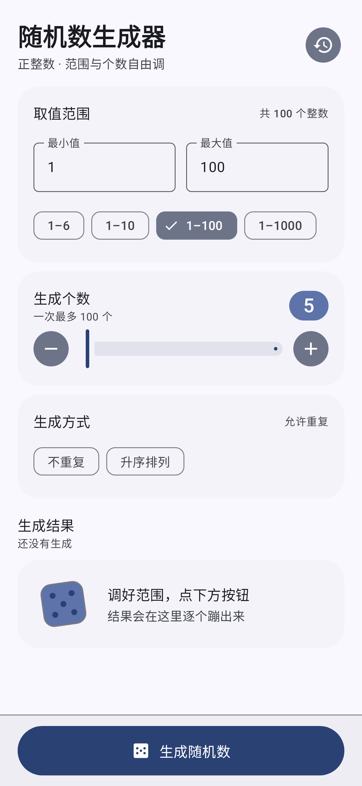
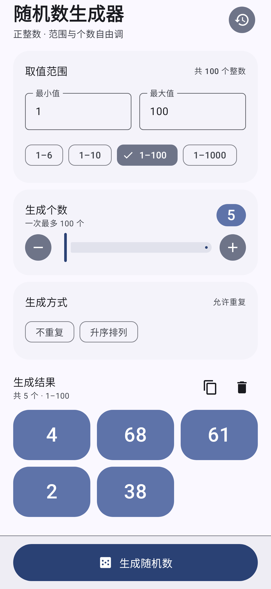
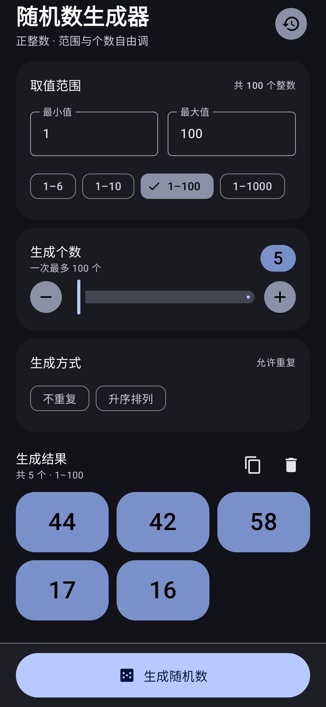

# 随机数生成器 · RDGenerator

一个 Android 端的正整数随机数生成器，界面使用 [Material Design 3](https://m3.material.io/)（Material You）。

范围和个数随手可调、结果一眼能读、每次生成都能回溯。

<p align="center">
  
  
  
</p>

## 功能

- **取值范围**：最小值 / 最大值两个输入框，仅接受正整数；内置 1–6、1–10、1–100、1–1000 四个快捷预设。
- **生成个数**：滑块 + 加减按钮，一次 1–100 个。
- **生成方式**：「不重复」「升序排列」两个开关。开启不重复后，个数超过区间容量会自动提示并禁用生成。
- **结果区**：自适应网格卡片，逐个缩放淡入；支持一键复制（逗号分隔）与清空。
- **历史记录**：最近 30 次生成落盘（SharedPreferences + JSON），点任意一条可恢复当时的范围、个数、选项与结果。
- **主题**：Android 12+ 跟随系统动态取色，Android 8.0–11 使用 MD3 基线紫色板；支持深色模式与 edge-to-edge。
- **无网络权限**：所有随机数在本机由 `SecureRandom` 生成，不联网、不上传。

## 下载

从 [Releases](../../releases) 下载最新 APK，或自行构建（见下）。

> 签名说明：发布包使用 debug 证书签名，便于直接安装体验，`debuggable=false`。请勿将其用于应用商店发布。

## 构建

环境要求：JDK 17+、Android SDK（compileSdk 37 / build-tools 37）。

```bash
# 指向你的 Android SDK
echo "sdk.dir=/path/to/Android/Sdk" > local.properties

./gradlew assembleRelease
```

Windows 下用 `gradlew.bat`。产物位于 `app/build/outputs/apk/release/`。

工具链：Gradle 9.6.1 / AGP 9.3.1 / Kotlin 2.4.10（含 Compose 编译器插件）/ compileSdk 37 / minSdk 26 / targetSdk 37。

## 测试

```bash
./gradlew testDebugUnitTest
```

- `RandomEngineTest`：生成逻辑的边界与均匀性（纯 JVM，12 项）。
- `GeneratorUiTest`：Robolectric 下的界面行为——生成、校验禁用、复制到剪贴板、历史恢复（6 项）。

### 截图核对

项目在 JVM 上用 Robolectric 真实渲染界面，无需真机或模拟器：

```bash
./gradlew testDebugUnitTest -Prdgen.screenshots=true --tests 'com.rdgen.app.Screenshot*'
```

输出在 `app/build/screenshots/`。`screenshots/` 目录是随仓库归档的核对结果（首次运行该任务会下载约 190 MB 的 Robolectric 运行时镜像）。

## 项目结构

```
app/src/main/java/com/rdgen/app/
├── MainActivity.kt              # 入口，edge-to-edge
├── core/RandomEngine.kt         # 纯逻辑：均匀采样 + 不重复 + 排序
├── data/HistoryStore.kt         # 历史记录落盘
├── ui/GeneratorScreen.kt        # 主界面
├── ui/HistorySheet.kt           # 历史记录底部面板
├── ui/components/AppIcons.kt    # 手写 ImageVector（避免引入 material-icons-extended）
├── ui/components/DiceArt.kt     # 空状态骰子插画
└── ui/theme/Theme.kt            # MD3 配色 / 字体 / 形状
```

## 实现要点

**均匀采样**：`RandomEngine.nextInRange` 使用拒绝采样消除取模偏差，先把 63 位随机数截到非负，再丢弃不能整除区间长度的尾部。

**不重复采样**：区间不大时直接构造候选池后做部分 Fisher–Yates 洗牌；区间远大于个数时退回 HashSet 去重重试，避免为了一百个数分配超大数组。

**状态保存**：输入与结果走 `rememberSaveable`，旋转和进程重建都不丢；历史记录单独落盘。

## 许可

[Apache License 2.0](LICENSE)
